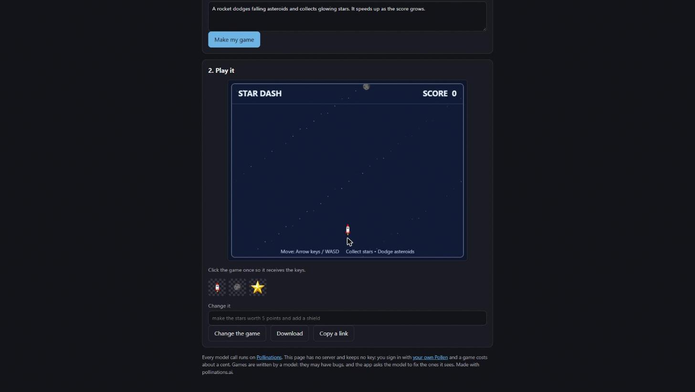

# Sprite Arcade

[](https://pollinations.ai/?ref=badge)

**Live:** https://tomdacatto.github.io/pollinations-sprite-arcade/

Pollinations quest [#20021](https://github.com/pollinations/pollinations/issues/20021): describe a game and get a playable one you can share, built on Pollinations models, with the visitor paying from their own balance.



## How it works

1. **A model writes the game and plans its sprites.** `openai/gpt-6-luna` replies with up to four sprite lines (`- name: image prompt`) and one self-contained HTML game that draws them as `window.SPRITES.<name>`. Code reads the reply ([`forge.js`](forge.js)): it refuses a reply with no HTML block, no canvas, a page over 60 KB, or code that uses a sprite that was not listed, and tells the model what was wrong for one retry.
2. **A free image model draws each sprite** (`zimage`, 256 px) on a flat magenta background, and **code cuts it out**: `keyMagenta` turns magenta to transparent, feathers the edge and pulls the pink out of it, so the sprites sit on the game with no halo.
3. **The game runs in `<iframe sandbox="allow-scripts">`.** It has no origin, so model-written code cannot read the visitor's Pollen sign-in key from `sessionStorage`. A crash inside it is posted to the page, which offers to have the model fix it.
4. **Change, download, share.** "Change the game" sends the request back to the model with the whole conversation. "Download" gives one HTML file. "Copy a link" puts the whole game, compressed, in the URL fragment (nothing is uploaded); whoever opens it plays at once, with no sign-in and no Pollen.

Both models are free for every visitor (`paid_only: false` on `/v1/models`). A game costs one to two cents of Pollen, mostly the three images; the app asks for 0.3 Pollen and one day at sign-in.

## Real runs

On the live code with my own Pollen, in desktop Chrome:

- **"A rocket dodges falling asteroids and collects glowing stars. It speeds up as the score grows."** gave *Star Dash* with a rocket, asteroid and star sprites, about 50 seconds from click to playing. The rocket stayed on screen, stars and asteroids fell, and when I held the left arrow in the game (synthetic key events) the rocket moved left. The screenshot is that game.
- **"A frog hops across lily pads to catch flies before the timer runs out."** gave a frog, lily pad and fly. I then asked "add a score multiplier that doubles points for catching flies in a row" and the game came back changed (its source now has a multiplier). I did not play the changed version through.
- **Sharing:** the rocket game was 22.8 KB as one page and 19.5 KB as a link; the link decoded to the identical page and loaded as a shared game with the tools hidden.

Together the runs, the sprite probe and the tests cost about 0.03 Pollen of the key's budget.

## Run the tests

```bash
npm test
```

10 `node --test` tests: the request, the reply parser (sprites kept, bad lines skipped, the four-sprite cap, each reason a reply is refused, a repair that keeps the known sprites), the magenta keying on synthetic pixels (pure magenta, the purple the model actually draws, a pale edge, red, blue, white), the page assembly in a head, a bare html tag and no tags (and a sprite value that cannot close the script), the share round trip, and the sign-in link.

## Not verified

- Games are model-written and untested beyond a run or two: I played one for a few seconds with synthetic keys, did not play either to a game over, and do not know how often a game crashes. The crash banner and the "ask the model to fix it" button were not triggered.
- The model does the game design; sprite style is whatever `zimage` returns for the prompt, and magenta keying can leave a faint fringe on pink objects.
- Desktop Chrome only: no phone, no touch controls, no Safari or Firefox (sprites are saved as WebP; where a browser cannot encode it the canvas falls back to PNG and links get longer, which I did not test).
- A shared link is the whole game, about 20 KB here and more with more sprites; some chat apps cut very long links, which is why Download exists.
- The sign-in redirect on the live address was not run (the key was loaded into the page for the tests).

MIT licence.
